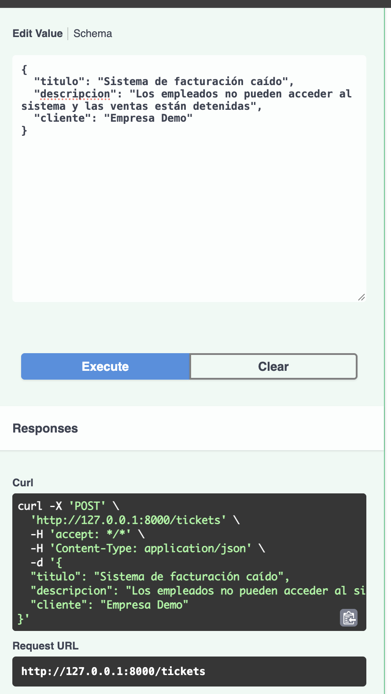
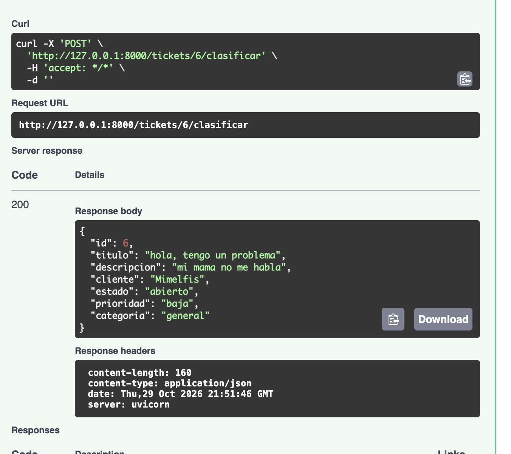
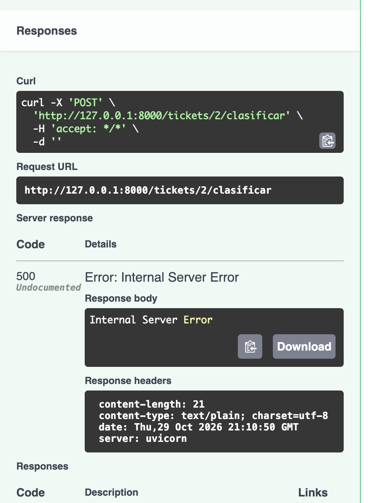

# SmartDesk AI

API REST para la gestión de tickets de soporte técnico, desarrollada con Python, FastAPI y SQLite, que integra inteligencia artificial mediante Google Gemini para clasificar automáticamente los tickets.

## Tecnologías

- Python 3.12
- FastAPI
- SQLite
- Pydantic
- Google Gemini API
- HTTPX
- uv

## Funcionalidades

- Crear tickets de soporte.
- Consultar todos los tickets.
- Consultar un ticket por ID.
- Actualizar tickets.
- Eliminar tickets.
- Clasificar tickets con inteligencia artificial.
- Guardar la prioridad y categoría generadas por Gemini.
- Validar los datos de entrada mediante Pydantic.
- Manejar errores HTTP, incluyendo 404 y 422.

## Instalación

Clonar el repositorio:

```bash
git clone URL_DEL_REPOSITORIO
cd smartdesk-ai
```

Instalar las dependencias:

```bash
uv sync
```

Crear un archivo `.env` a partir de `.env.example` y configurar:

```dotenv
GEMINI_API_KEY=tu_api_key
```

## Ejecutar la aplicación

```bash
uv run uvicorn main:app --reload
```

Abrir la documentación interactiva:

http://127.0.0.1:8000/docs

La base de datos SQLite se crea automáticamente al iniciar la aplicación.

## Endpoints

| Método | Endpoint | Descripción |
|---|---|---|
| POST | `/tickets` | Crear ticket |
| GET | `/tickets` | Listar tickets |
| GET | `/tickets/{ticket_id}` | Consultar ticket |
| PUT | `/tickets/{ticket_id}` | Actualizar ticket |
| DELETE | `/tickets/{ticket_id}` | Eliminar ticket |
| POST | `/tickets/{ticket_id}/clasificar` | Clasificar ticket mediante Gemini |

## Ejemplo de creación de ticket

```json
{
  "titulo": "Sistema de facturación caído",
  "descripcion": "Los empleados no pueden procesar las ventas.",
  "cliente": "Empresa Demo"
}
```

## Ejemplo de clasificación con IA

Solicitud:

```http
POST /tickets/1/clasificar
```

Ejemplo de respuesta:

```json
{
  "id": 1,
  "titulo": "Sistema de facturación caído",
  "descripcion": "Los empleados no pueden procesar las ventas.",
  "cliente": "Empresa Demo",
  "estado": "abierto",
  "prioridad": "alta",
  "categoria": "facturación"
}
```

La prioridad y categoría son determinadas por Gemini y almacenadas en SQLite. Los resultados pueden variar según el contenido del ticket.

## Validaciones y errores

Los campos `titulo`, `descripcion` y `cliente` tienen restricciones de longitud mínima.

- `404`: ticket no encontrado.
- `422`: datos de entrada inválidos.
- `502`: error de respuesta del proveedor de IA.
- `504`: tiempo de espera agotado al consultar el modelo.

## Capturas de Swagger

Agregar aquí las capturas de pantalla de los endpoints funcionando.

## Seguridad

Las credenciales se almacenan en variables de entorno y el archivo `.env` está excluido del control de versiones.

El proyecto utiliza datos ficticios con fines educativos.

## Evidencias de funcionamiento

### 1. Creación de un ticket



### 2. Clasificación automática con Google Gemini



### 3. Consulta del ticket y persistencia de la clasificación

